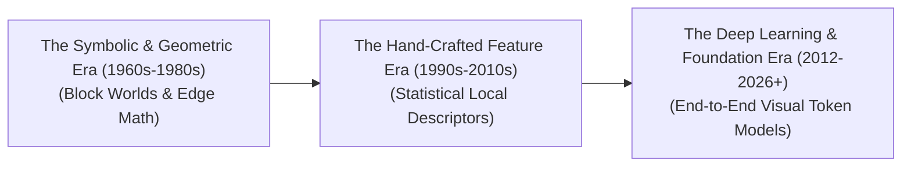

# Awesome-Computer-Vision 👁️🤖⚡

<meta name="description" content="A curated list of awesome computer vision papers, open-source repositories, foundational architectures, vision transformers, SaaS tools, and production visual AI engineering mitigations." />
<meta name="keywords" content="awesome computer vision, computer vision, deep learning, vision transformer, ViT, YOLO, object detection, segmentation, multimodal AI, PyTorch, OpenCV, visual AI pipelines, image classification" />

  

     

## 🚀 Computer Vision (CV): History, Progression, Evolution, & Paradigms

Computer Vision (CV) is a foundational discipline of Artificial Intelligence dedicated to enabling digital systems to process, interpret, visually reconstruct, and reason about visual data—such as images, videos, and multi-dimensional spatial grids. Over more than six decades, the field has transitioned from basic binary line extraction to hand-crafted geometric models, statistical feature engineering, and modern web-scale multimodal foundation networks. What began as a brief summer academic project has evolved into a ubiquitous cognitive layer driving global industrial automation, medical diagnostics, autonomous transport, and human-computer synthesis.

---

## 📅 1. The Macro Chronological Evolution

The overarching trajectory of Computer Vision reflects a systemic shift from hand-crafted mathematical rules and symbolic geometry to data-driven deep representations and unified multimodal sequence spaces.

| Era | Core Concept | Limitations | First Used Year | First Paper Reference |
| :--- | :--- | :--- | :---: | :--- |
| [**The Symbolic, Geometric, & "Block Worlds" Era (~1960s–1980s)**](details/symbolic_geometric_era.md) | Vision as a sequential process of edge extraction followed by geometric reasoning. Larry Roberts' PhD thesis proved that 3D structures could be reconstructed from 2D drawings. Relied on hardcoded mathematical calculus (Sobel, Canny, Marr's paradigm). | Rigidly fragile. Collapsed when introduced to natural lighting variations, occlusions, background noise, or non-geometric real-world objects. | 1963 | [Roberts (1963)](https://dspace.mit.edu/handle/1721.1/11580) [[1]](#references) |
| [**The Statistical & Hand-Crafted Feature Descriptor Era (~1990s–2011)**](details/statistical_descriptor_era.md) | Invariant local descriptors. Hand-crafted feature extractors statistically invariant to scale, illumination, and rotation (SIFT, HOG, Viola-Jones), routed through Support Vector Machines (SVMs). | Heavy human engineering bottleneck. Required years of manual math tuning; incapable of learning higher-level semantic contexts natively. | 1999 | [Lowe (1999)](https://www.cs.ubc.ca/~lowe/papers/iccv99.pdf) [[3]](#references) |
| [**The Deep Learning, Transformer, & Foundation Era (2012–Present)**](details/deep_learning_foundation_era.md) | End-to-end Convolutional Neural Networks (CNNs) learning representations directly from data. Evolved into Vision Transformers (ViT) and Multimodal Foundation Models (CLIP, SigLIP, GPT-4o) sharing unified latent token spaces. | None (Represents the modern state-of-the-art paradigm) | 2012 | [Krizhevsky et al. (2012)](https://proceedings.neurips.cc/paper/2012/file/c3982bc38707c31290350448aa57c9a6-Paper.pdf) [[6]](#references) |

---

## ⚙️ 2. Core Methodological Paradigms

Depending on the underlying mathematical strategy used to transform pixel fields into actionable representations, the evolution of CV is characterized by distinct algorithmic schools.

| Paradigm | Mechanism | Key Algorithms / Architectures | First Used Year | First Paper Reference |
| :--- | :--- | :--- | :---: | :--- |
| [**A. Classical Mathematical & Edge-Based Vision**](details/classical_mathematical_vision.md) | Applies spatial gradient operators across an image to detect discontinuities in brightness, utilizing Hough transforms to link edges into structural shapes. | Canny Edge Detection, Sobel Filters, and Laplacian of Gaussian. | 1968 | [Sobel (1968)](https://research.gatech.edu/sites/default/files/2021-08/A%203x3%20Isotropic%20Gradient%20Operator%20for%20Image%20Processing.pdf) |
| [**B. Local Feature Matching & Keypoint Pipelines**](details/local_feature_matching.md) | Scans images for highly salient localized anchor points (like corners or high-contrast blobs), creating a mathematical patch vector descriptor that can be searched and matched across different camera angles. | SIFT, SURF, ORB, and Harris Corner Detection. | 1988 | [Harris & Stephens (1988)](https://www.bmva.org/conferences/avc/1988/050.pdf) |
| [**C. Connectionist Deep Spatial Encoding (CNNs)**](details/connectionist_deep_spatial_encoding.md) | Implements localized convolutional kernels [7] that slide across a canvas, enforcing translation invariance and local connectivity. Stacks representations hierarchically from raw lines to full object semantics. | ResNet, VGG, MobileNet, and ConvNeXt. | 1989 | [LeCun et al. (1989)](http://yann.lecun.com/exdb/publis/pdf/lecun-89e.pdf) |
| [**D. Attention-Driven Visual Patchification (ViTs)**](details/attention_driven_visual_patchification.md) | Discards convolutional assumptions. Flattens an image into non-overlapping grids of $14 \times 14$ or $16 \times 16$ pixel patches, projecting them linearly into a sequence of tokens processed via self-attention mechanisms. | Vanilla ViT, Swin Transformer, and Multi-Head Latent Attention (MLA). | 2020 | [Dosovitskiy et al. (2020)](https://arxiv.org/abs/2010.11929) [[8]](#references) |

---

## 📊 3. The Core Vision Task Hierarchy

As the field expanded, the operational objectives of computer vision scaled from global image sorting to dense spatial tracking and 3D geometric synthesis.

| Task Complexity | Technical Objective | Modern AI Architecture | Real-World Application |
| :--- | :--- | :--- | :--- |
| **Image Classification** | Assigns a single categorical label to a complete visual frame. | ResNet, ConvNeXt, ViT | Catalog tagging, broad sorting. |
| **Object Detection** | Identifies the semantic class and draws an explicit 2D coordinate bounding box around entities. | YOLO, Grounding DINO, Deformable DETR | Autonomous vehicle obstacle tracking, security feeds. |
| **Semantic / Instance Segmentation** | Maps classification probabilities to every individual pixel coordinate, tracing absolute contours. | U-Net, Mask R-CNN, Segment Anything (SAM) | Medical tumor outline mapping, satellite crop zoning. |
| **Visual Grounding / OVM** | Localizes and masks arbitrary objects using free-form natural language prompts at inference time. | OWL-ViT, Grounded-SAM, OWL-ViT v2 | Zero-shot warehouse automation, open-set screening. |
| **Spatio-Temporal VideoQA** | Tracks logical cause-and-effect transitions and motions across chronological multi-frame video tokens. | Spatio-Temporal Diffusion Transformers (Sora, LTX-Video) | Predictive security analytics, automated sports auditing. |

---

## 🛠️ 4. Production Engineering Challenges & Historical Mitigations

Translating computer vision code from clean academic datasets into volatile, real-world physical deployment architectures introduces severe system bottlenecks.

| Engineering Challenge | The Bottleneck | Mitigation | First Used Year | First Paper Reference |
| :--- | :--- | :--- | :---: | :--- |
| [**The Quadratic Context and Patch Explosion Problem**](details/quadratic_context_patch_explosion.md) | Slicing multi-megapixel graphics into fine-grained visual patches creates thousands of active tokens. Feeding them into standard attention graphs triggers a quadratic ($O(N^2)$) memory footprint spike, saturating GPU VRAM instantly. | Implementing **Dynamic Resolution Patching (AnyRes)** (processing coarse thumbnails and zoomed-in local sub-patches concurrently), coupled with **Linear Attention or Latent Compression Kernels**. | 2024 | [Liu et al. (LLaVA-NeXT) (2024)](https://arxiv.org/abs/2401.18059) |
| [**The "Picasso Problem" and Inductive Bias Drift**](details/picasso_problem_inductive_bias.md) | Early CNNs overfitted to pure textures. Standard Vision Transformers lack the native spatial assumptions (inductive biases) of convolutions, requiring billions of images to understand basic object orientations without warping features. | Deploying **Hybrid Vision Architectures** (blending local convolutional stems with global self-attention blocks), optimized via self-supervised masked autoencoding (MAE). | 2017 | [Sabour et al. (Capsule Networks) (2017)](https://arxiv.org/abs/1710.09829) |

---

## 🌟 5. Modern Frontier Applications

| Application Field | Technical Description & Workflow | First Used Year | First Paper Reference |
| :--- | :--- | :---: | :--- |
| [**Autonomous Vehicle Perception & Bird's-Eye-View (BEV) Stacks**](details/autonomous_vehicle_perception_bev.md) | Merges continuous high-frame-rate streaming cameras, LiDAR 3D point clouds, and Radar data simultaneously. Deep spatial transformers project inputs into a unified 3D BEV vector space, executing lane segmentation and multi-object collision-avoidance logic. | 2020 | [Philion & Fidler (LSS) (2020)](https://arxiv.org/abs/2008.05711) |
| [**Multimodal GUI Document Auditing & Robotic Grounding**](details/multimodal_gui_document_auditing.md) | Powers vision-language model (VLM) operational agents. Processes interface screenshots, high-res blueprints, or complex multi-axis charts, extracting layout metrics to execute tool-augmented office tasks or calculate robotic tool manipulation vectors. | 2023 | [Brohan et al. (RT-2) (2023)](https://arxiv.org/abs/2307.15818) |
| [**High-Fidelity Generative Flow Matching & Video Synthesis**](details/high_fidelity_generative_flow_matching.md) | Drives advanced generative physical simulators. By reversing ordinary differential equation (ODE) straight-line trajectories over noise tensors, spatial diffusion models synthesize photorealistic, physically consistent video sequences from text prompts. | 2022 | [Lipman et al. (Flow Matching) (2022)](https://arxiv.org/abs/2210.02099) |

---

## 📚 References

1. Roberts, L. G. (1963). *Machine Perception of Three-Dimensional Solids* (Doctoral dissertation, Massachusetts Institute of Technology).
2. Marr, D. (1982). *Vision: A computational investigation into the human representation and processing of visual information*. W. H. Freeman and Company.
3. Lowe, D. G. (1999). Object recognition from local scale-invariant features. *Proceedings of the Seventh IEEE International Conference on Computer Vision*, 2, 1150-1157.
4. Dalal, N., & Triggs, B. (2005). Histograms of oriented gradients for human detection. *IEEE Computer Society Conference on Computer Vision and Pattern Recognition (CVPR)*, 1, 886-893.
5. Viola, P., & Jones, M. (2001). Rapid object detection using a boosted cascade of simple features. *Proceedings of the 2001 IEEE Computer Society Conference on Computer Vision and Pattern Recognition (CVPR)*, 1, I-I.
6. Krizhevsky, A., Sutskever, I., & Hinton, G. E. (2012). ImageNet classification with deep convolutional neural networks. *Advances in Neural Information Processing Systems*, 25, 1097-1105.
7. He, K., Zhang, X., Ren, S., & Sun, J. (2016). Deep residual learning for image recognition. *Proceedings of the IEEE Conference on Computer Vision and Pattern Recognition (CVPR)*, 770-778.
8. Dosovitskiy, A., et al. (2020). An image is worth 16x16 words: Transformers for image recognition at scale. *arXiv preprint arXiv:2010.11929*.
9. Radford, A., et al. (2021). Learning transferable visual models from natural language supervision. *International Conference on Machine Learning (ICML)*, 8748-8763.

---

## 🌐 Top Computer Vision Ecosystem

**Curated Index of Leading SaaS Platforms & Open-Source GitHub Repositories**  
*Focused on Image Classification, Object Detection, Segmentation, 3D Vision & Visual AI Pipelines*  
**Last updated: March 2026**

This section tracks notable **SaaS platforms** and **open-source projects** across the computer vision landscape. These tools enable developers, ML engineers, and researchers to build, annotate, train, optimize, and deploy models that interpret images and video feeds—powering mission-critical applications from autonomous vehicles and robotics to industrial inspection and spatial intelligence.

---

## 📑 Table of Contents

- [📈 Sector Overview & Market Dynamics](#-sector-overview--market-dynamics)
- [☁️ SaaS/Hosted Platforms](#️-saashosted-platforms)
- [🐙 Open-Source GitHub Projects](#-open-source-github-projects)
- [⭐ Star History](#-star-history)
- [💖 Support & Sponsorship](#-support--sponsorship)
- [🤝 How to Contribute](#-how-to-contribute)
- [⚖️ Disclaimer](#️-disclaimer)

---

## 📈 Sector Overview & Market Dynamics

The global computer vision market is estimated at **$23.6B–$28.2B (2025–2026)** and projected to exceed **$100B by the 2030s** (~16–20% CAGR). The sector exhibits a **hybrid structure**: foundational compute silicon and edge accelerators (e.g., NVIDIA, Qualcomm) are **highly concentrated**, whereas the vertical SaaS, data annotation, and specialized inspection software layers remain **moderately fragmented** with intense competition across domain-specific vision intelligence and data workflows.

---

## ☁️ SaaS/Hosted Platforms

| Platform | Company Size (Valuation / Revenue) | Description | Starting Tier Pricing | Free Tier / Trial Limits |
| :--- | :--- | :--- | :--- | :--- |
| **[Scale AI](https://scale.com/)** | ~$29.0B Valuation (~$1.0B–$2.0B Revenue) | Enterprise data annotation, curation, RLHF, and visual evaluation platform for production AI. | $0.05/labeling unit (Self-serve) / Custom enterprise (contracts avg. $93k+/yr) | Free tier: 1,000 labeling units (self-serve); Free academic/research access for Nucleus curation. No time-limited free trial. |
| **[Encord](https://encord.com/)** | ~$550M Valuation (Series C, $110M raised) | Data-centric computer vision platform with dynamic ontologies, multimodal labeling, active learning, and curation. | Paid tiers custom-scoped (Starter tier is self-serve free) | Starter Plan: 100% Free forever (up to 5 seats, core image/video annotation toolkits, dynamic ontologies, self-serve support; excludes data agents). Demo required for Team trial. |
| **[Landing AI](https://landing.ai/)** | ~$250M Est. Valuation (~$15M–$34M ARR) | Industrial visual inspection, defect detection, and agentic document vision intelligence platform founded by Andrew Ng. | $250/mo (Agentic Document API / 25,000 credits) / Custom enterprise for LandingLens inspection | Free tier: 1,000 credits/month (1 credit per image trained/inferred), max 10,000 images/project, 1 deployed model download (non-commercial), up to 3 org seats. |
| **[Roboflow](https://roboflow.com/)** | ~$160M Valuation (~$63.6M+ raised) | End-to-end dataset preparation, labeling, augmentation, model training, and edge/cloud deployment platform. | $39/mo (Starter/Core monthly plan) | Free Plan (Public/Free Core): 10–20 credits/month refresh, private datasets & workspaces supported, free self-hosted inference via Roboflow Inference, 1 user seat. |
| **[Clarifai](https://www.clarifai.com/)** | ~$100M+ Est. ($101M raised; acquired by Nebius) | Production visual tagging, custom classification/detection training, and hosted inference platform. | $30/mo (Community Essential tier; includes $30 usage credits) | Community Plan: 100% Free forever (1,000 operations/month, 1,000 input objects, 1 application, 1 custom trained model, 1 custom workflow, 1 hr deep training/mo). |
| **[V7 Labs](https://www.v7labs.com/)** | ~$100M Valuation (~$36M+ raised) | AI-powered image, video, and medical/document annotation platform featuring automated segmentation. | $249/mo (V7 Go Pro) / $499/mo (V7 Darwin Starter) | 14-day free trial on platform plans (full access to core annotation and automated segmentation features with scoped proof-of-concept onboarding). |
| **[OpenCV.ai](https://opencv.ai/)** | Commercial entity of OpenCV (~$10M–$20M Ecosystem) | Commercial services and enterprise long-term support arm of the OpenCV open-source ecosystem. | $6,000/yr ($500/mo Bronze Membership) / $150,000/yr (Enterprise LTS Maintenance) | Free Core Library: 100% free forever under Apache-2.0 license (2,500+ algorithms, unlimited local/commercial use; enterprise SLA/consulting packages require commercial contract). |
| **[AlwaysAI](https://alwaysai.co/)** | ~$7M–$8M ARR (~$16M raised) | Edge computer vision and IoT analytics platform for deploying real-time vision applications on embedded hardware. | Custom enterprise quotes / Hardware-bundled developer licenses | Free developer evaluation via guided demonstration and site proof-of-concept (POC); self-serve free tier deprecated in favor of custom pilot assessments. |
| **[Supervisely](https://supervisely.com/)** | ~$1M–$1.5M ARR (Bootstrapped / Non-VC funded) | Modular web operating system for computer vision with 2D/3D annotation, video tracking, and LiDAR workflows. | €199/mo (~$215/mo Pro tier) | Community Edition: 100% Free forever for individuals/researchers (core labeling apps, basic cloud storage, community support). Pro tier includes a 30-day free trial. |
| **[Ultralytics HUB](https://hub.ultralytics.com/)** | Category leader in detection (Ultralytics ecosystem) | No-code end-to-end ML platform for training and deploying YOLO models on cloud NVIDIA GPUs. | $29/seat/mo (Pro plan; includes $30/mo GPU compute credits) | Free Plan: 100% Free forever ($5 one-time credit, or $25 with verified work email; 100 GB storage with max 10 GB/upload, up to 100 models, 3 concurrent cloud trainings, 3 cloud deployments, unlimited public/private projects). |

---

## 🐙 Open-Source GitHub Projects

Curated list of leading open-source computer vision libraries, detection frameworks, model zoos, dataset tools, and inference accelerators, sorted in descending order by GitHub stargazer count.

- **[TensorFlow](https://github.com/tensorflow/tensorflow)**   
  End-to-end open-source machine learning platform (Apache-2.0). Keras high-level API for building image classification models, with prebuilt layers for CNNs, data augmentation, and transfer learning. TensorFlow Lite enables mobile and edge deployment.

- **[PyTorch](https://github.com/pytorch/pytorch)**   
  Leading deep learning framework (BSD license) with first-class computer vision support. Powers TorchVision with pretrained ResNet, VGG, EfficientNet, and ConvNeXt models with ImageNet weights, plus data loading and augmentation utilities.

- **[OpenCV](https://github.com/opencv/opencv)**   
  The most widely used computer vision and image processing library (Apache-2.0). Features 2,500+ optimized algorithms covering image processing, feature detection, object tracking, and DNN module for running pretrained models across C++, Python, Java, and JavaScript.

- **[Ultralytics YOLO](https://github.com/ultralytics/ultralytics)**   
  The industry-standard real-time object detection framework (AGPL-3.0). Supports detection, segmentation, pose estimation, and classification across YOLOv8, YOLOv9, YOLOv10, YOLOv11, and YOLOv12 with FlashAttention and region attention.

- **[Segment Anything (SAM / SAM 2)](https://github.com/facebookresearch/segment-anything)**   
  Meta AI's foundation model for zero-shot image and video segmentation (Apache-2.0). Enables promptable segmentation for points, boxes, and text prompts across complex visual scenes.

- **[Gradio](https://github.com/gradio-app/gradio)**   
  Build and share ML and CV web demos (Apache-2.0). Quick UI for computer vision models with drag-and-drop file upload, webcam capture, and real-time streaming inference.

- **[Timm (PyTorch Image Models)](https://github.com/huggingface/pytorch-image-models)**   
  Massive collection of pretrained visual neural network backbones (Apache-2.0). Includes ResNet, EfficientNet, ViT, Swin Transformer, ConvNeXt, and hundreds more with state-of-the-art ImageNet weights.

- **[Detectron2](https://github.com/facebookresearch/detectron2)**   
  Modular detection, instance segmentation, and pose estimation framework by Meta AI (Apache-2.0). Foundation for dense spatial research and production computer vision stacks.

- **[MMDetection](https://github.com/open-mmlab/mmdetection)**   
  OpenMMLab detection toolbox (Apache-2.0) with modular configs and hundreds of pretrained models. Part of the broader OpenMMLab computer vision ecosystem.

- **[Label Studio](https://github.com/HumanSignal/label-studio)**   
  Multi-domain open-source data labeling platform (Apache-2.0) for building high-quality visual classification, bounding box, semantic polygon, and keypoint training datasets.

- **[ONNX Runtime](https://github.com/microsoft/onnxruntime)**   
  Cross-platform, high-performance scoring engine (MIT) by Microsoft for deploying computer vision models with hardware acceleration on CPUs, GPUs, and NPUs.

- **[TorchVision](https://github.com/pytorch/vision)**   
  Official PyTorch computer vision library (BSD license). Features classification, detection, keypoint, and segmentation models, standard benchmark datasets, and GPU-accelerated transforms.

- **[CVAT](https://github.com/cvat-ai/cvat)**   
  Computer Vision Annotation Tool (MIT) for digital image and video labeling with automated interpolation, semi-automatic AI tracking, and multi-user management.

- **[Albumentations](https://github.com/albumentations-team/albumentations)**   
  High-performance image augmentation library (MIT) optimized for deep learning pipelines, supporting bounding boxes, keypoints, and segmentation masks.

- **[PaddleDetection](https://github.com/PaddlePaddle/PaddleDetection)**   
  Object detection toolkit (Apache-2.0) powered by PaddlePaddle, featuring PP-YOLO, PP-PicoDet, pedestrian tracking, and lightweight embedded deployment tools.

- **[TensorRT](https://github.com/NVIDIA/TensorRT)**   
  NVIDIA SDK for high-performance deep learning inference (Apache-2.0), providing FP16/INT8 precision calibration and kernel fusion for millisecond CV inference on NVIDIA GPUs.

- **[Kornia](https://github.com/kornia/kornia)**   
  Differentiable computer vision library (Apache-2.0) for PyTorch. Enables classical CV algorithms (filtering, geometric warping, feature detection) to execute as differentiable GPU tensor operations.

- **[FiftyOne](https://github.com/voxel51/fiftyone)**   
  Open-source tool (Apache-2.0) for curating high-quality datasets, finding annotation mistakes, visualizing embeddings, and evaluating visual AI models.

- **[OpenVINO](https://github.com/openvinotoolkit/openvino)**   
  Intel's open-source toolkit (Apache-2.0) for optimizing and deploying deep learning computer vision workloads with low latency across Intel CPUs, integrated GPUs, and VPUs.

- **[Grounding DINO](https://github.com/IDEA-Research/GroundingDINO)**   
  Open-set object detector (Apache-2.0) marrying DINO with grounded pre-training to detect arbitrary objects referenced through open-vocabulary natural language phrases.

- **[scikit-image](https://github.com/scikit-image/scikit-image)**   
  Collection of algorithms for image processing in Python (BSD-3-Clause), covering color transformations, morphological operations, thresholding, and geometric analysis.

- **[SAHI (Slicing Aided Hyper Inference)](https://github.com/obss/sahi)**   
  Lightweight vision framework (MIT) for small object detection via image slicing and tiling, bridging detectors like YOLO and MMDetection on high-resolution aerial and satellite imagery.

- **[SuperGradients](https://github.com/Deci-AI/super-gradients)**   
  PyTorch-based computer vision training library (Apache-2.0) with recipes for classification, detection, and segmentation featuring automated hyperparameter tuning and hardware-aware optimization.

- **[OpenMMLab Ecosystem](https://github.com/open-mmlab)**  
  Comprehensive CV research and deployment ecosystem including MMPretrain, MMDetection, MMDetection3D, MMYOLO, and MMSegmentation with over 100,000+ collective stars.

---

## ⭐ Star History

---

## 💖 Support & Sponsorship

Thank you for visiting **Awesome-Computer-Vision**! 🌟  

If you find this repository helpful for your machine learning engineering, research papers, or visual AI projects, please consider supporting the project:
* ⭐ **Star** this repository on GitHub to help others discover it.
* 🍴 **Fork** and contribute enhancements, architectures, or fresh tools.
* 📢 **Share** with your colleagues, lab members, and community.
* ☕ **Buy me a coffee / Sponsor**: Support ongoing maintenance and open-source curation on the [GitHub Sponsor Dashboard](https://github.com/sponsors/ishandutta2007).

---

## 🤝 How to Contribute

1. 🍴 Fork the repository.
2. ✍️ Add or edit entries in `README.md` following the established formatting guidelines.
3. 📝 Include: name, link, 1–2 sentence description, and whether it's SaaS or open-source.
4. 🚀 Submit a pull request with a brief summary of additions.

---

## ⚖️ Disclaimer

- This is a **community-curated** list — not exhaustive and not an official commercial endorsement.
- Computer vision systems processing images and video must strictly comply with privacy, biometric, and data protection regulations (GDPR, BIPA, CCPA, etc.).
- **Open-source computer vision is production-ready.** OpenCV, YOLO, and the OpenMMLab ecosystem power countless commercial deployments. The gap between open-source and proprietary CV models has narrowed significantly.
- **Model licensing varies.** Ultralytics YOLO is AGPL-3.0—commercial use requires either open-sourcing your application or purchasing an enterprise license. OpenCV, PyTorch, and TorchVision are permissive (Apache-2.0/BSD). Always verify repository license files before commercial deployment.
- **Dataset quality determines model performance.** Garbage in, garbage out applies doubly to CV—annotation errors, class imbalance, and distribution shift are the most common failure modes. FiftyOne, Label Studio, and CVAT exist specifically to diagnose and resolve these hurdles.
- Self-hosted open-source solutions require proper GPU provisioning, model versioning, and ongoing maintenance for production reliability. Edge deployments require additional compilation (quantization, pruning) via OpenVINO or TensorRT.

---

**Made with ❤️ for ML engineers, computer vision researchers, and developers building transparent visual AI solutions.**  
Let's make Computer Vision more open, data-driven, and accessible! 👁️✨

