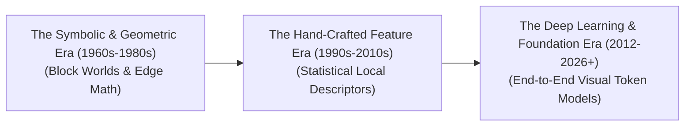

# Awesome-Computer-Vision 👁️🤖

<meta name="description" content="A curated list of awesome computer vision papers, evolution progression, architectures, tasks, and production engineering mitigations." />
<meta name="keywords" content="computer vision, deep learning, vision transformer, cnn, object detection, image classification, synthesis, BEV, RT-2, Flow Matching" />

  

     

## 🚀 Computer Vision (CV): History, Progression, Evolution, & Paradigms

Computer Vision (CV) is a foundational field of Artificial Intelligence dedicated to enabling digital systems to process, interpret, visually reconstruct, and reason about visual data, such as images, videos, and multi-dimensional spatial grids. Over more than six decades, the field has transitioned from basic binary line extraction to hand-crafted geometric models, statistical feature engineering, and modern web-scale multimodal foundation networks. What began as a brief summer academic project has evolved into a ubiquitous cognitive layer driving global industrial automation, medical diagnostics, autonomous transport, and human-computer synthesis.

---

## 📅 1. The Macro Chronological Evolution

The overarching trajectory of Computer Vision reflects a systemic shift from hand-crafted mathematical rules and symbolic geometry to data-driven deep representations and unified multimodal sequence spaces.

| Era | Core Concept | Limitations | First Used Year | First Paper Reference |
| :--- | :--- | :--- | :---: | :--- |
| [**The Symbolic, Geometric, & "Block Worlds" Era (~1960s–1980s)**](details/symbolic_geometric_era.md) | Vision as a sequential process of edge extraction followed by geometric reasoning. Larry Roberts' PhD thesis proved that 3D structures could be reconstructed from 2D drawings. Relied on hardcoded mathematical calculus (Sobel, Canny, Marr's paradigm). | Rigidly fragile. Collapsed when introduced to natural lighting variations, occlusions, background noise, or non-geometric real-world objects. | 1963 | [Roberts (1963)](https://dspace.mit.edu/handle/1721.1/11580) [[1]](#references) |
| [**The Statistical & Hand-Crafted Feature Descriptor Era (~1990s–2011)**](details/statistical_descriptor_era.md) | Invariant local descriptors. Hand-crafted feature extractors statistically invariant to scale, illumination, and rotation (SIFT, HOG, Viola-Jones), routed through Support Vector Machines (SVMs). | Heavy human engineering bottleneck. Required years of manual math tuning; incapable of learning higher-level semantic contexts natively. | 1999 | [Lowe (1999)](https://www.cs.ubc.ca/~lowe/papers/iccv99.pdf) [[3]](#references) |
| [**The Deep Learning, Transformer, & Foundation Era (2012–Present)**](details/deep_learning_foundation_era.md) | End-to-end Convolutional Neural Networks (CNNs) learning representations directly from data. Evolved into Vision Transformers (ViT) and Multimodal Foundation Models (CLIP, SigLIP, GPT-4o) sharing unified latent token spaces. | None (Represents the modern state-of-the-art paradigm) | 2012 | [Krizhevsky et al. (2012)](https://proceedings.neurips.cc/paper/2012/file/c3982bc38707c31290350448aa57c9a6-Paper.pdf) [[6]](#references) |

---

## ⚙️ 2. Core Methodological Paradigms

Depending on the underlying mathematical strategy used to transform pixel fields into actionable representations, the evolution of CV is characterized by distinct algorithmic schools.

| Paradigm | Mechanism | Key Algorithms / Architectures | First Used Year | First Paper Reference |
| :--- | :--- | :--- | :---: | :--- |
| [**A. Classical Mathematical & Edge-Based Vision**](details/classical_mathematical_vision.md) | Applies spatial gradient operators across an image to detect discontinuities in brightness, utilizing Hough transforms to link edges into structural shapes. | Canny Edge Detection, Sobel Filters, and Laplacian of Gaussian. | 1968 | [Sobel (1968)](https://research.gatech.edu/sites/default/files/2021-08/A%203x3%20Isotropic%20Gradient%20Operator%20for%20Image%20Processing.pdf) |
| [**B. Local Feature Matching & Keypoint Pipelines**](details/local_feature_matching.md) | Scans images for highly salient localized anchor points (like corners or high-contrast blobs), creating a mathematical patch vector descriptor that can be searched and matched across different camera angles. | SIFT, SURF, ORB, and Harris Corner Detection. | 1988 | [Harris & Stephens (1988)](https://www.bmva.org/conferences/avc/1988/050.pdf) |
| [**C. Connectionist Deep Spatial Encoding (CNNs)**](details/connectionist_deep_spatial_encoding.md) | Implements localized convolutional kernels [7] that slide across a canvas, enforcing translation invariance and local connectivity. Stacks representations hierarchically from raw lines to full object semantics. | ResNet, VGG, MobileNet, and ConvNeXt. | 1989 | [LeCun et al. (1989)](http://yann.lecun.com/exdb/publis/pdf/lecun-89e.pdf) |
| [**D. Attention-Driven Visual Patchification (ViTs)**](details/attention_driven_visual_patchification.md) | Discards convolutional assumptions. Flattens an image into non-overlapping grids of $14 \times 14$ or $16 \times 16$ pixel patches, projecting them linearly into a sequence of tokens processed via self-attention mechanisms. | Vanilla ViT, Swin Transformer, and Multi-Head Latent Attention (MLA). | 2020 | [Dosovitskiy et al. (2020)](https://arxiv.org/abs/2010.11929) [[8]](#references) |

---

## 📊 3. The Core Vision Task Hierarchy

As the field expanded, the operational objectives of computer vision scaled from global image sorting to dense spatial tracking and 3D geometric synthesis.

| Task Complexity | Technical Objective | Modern AI Architecture | Real-World Application |
| :--- | :--- | :--- | :--- |
| **Image Classification** | Assigns a single categorical label to a complete visual frame. | ResNet, ConvNeXt, ViT | Catalog tagging, broad sorting. |
| **Object Detection** | Identifies the semantic class and draws an explicit 2D coordinate bounding box around entities. | YOLO, Grounding DINO, Deformable DETR | Autonomous vehicle obstacle tracking, security feeds. |
| **Semantic / Instance Segmentation** | Maps classification probabilities to every individual pixel coordinate, tracing absolute contours. | U-Net, Mask R-CNN, Segment Anything (SAM) | Medical tumor outline mapping, satellite crop zoning. |
| **Visual Grounding / OVM** | Localizes and masks arbitrary objects using free-form natural language prompts at inference time. | OWL-ViT, Grounded-SAM, OWL-ViT v2 | Zero-shot warehouse automation, open-set screening. |
| **Spatio-Temporal VideoQA** | Tracks logical cause-and-effect transitions and motions across chronological multi-frame video tokens. | Spatio-Temporal Diffusion Transformers (Sora, LTX-Video) | Predictive security analytics, automated sports auditing. |

---

## 🛠️ 4. Production Engineering Challenges & Historical Mitigations

Translating computer vision code from clean academic datasets into volatile, real-world physical deployment architectures introduces severe system bottlenecks.

| Engineering Challenge | The Bottleneck | Mitigation | First Used Year | First Paper Reference |
| :--- | :--- | :--- | :---: | :--- |
| [**The Quadratic Context and Patch Explosion Problem**](details/quadratic_context_patch_explosion.md) | Slicing multi-megapixel graphics into fine-grained visual patches creates thousands of active tokens. Feeding them into standard attention graphs triggers a quadratic ($O(N^2)$) memory footprint spike, saturating GPU VRAM instantly. | Implementing **Dynamic Resolution Patching (AnyRes)** (processing coarse thumbnails and zoomed-in local sub-patches concurrently), coupled with **Linear Attention or Latent Compression Kernels**. | 2024 | [Liu et al. (LLaVA-NeXT) (2024)](https://arxiv.org/abs/2401.18059) |
| [**The "Picasso Problem" and Inductive Bias Drift**](details/picasso_problem_inductive_bias.md) | Early CNNs overfitted to pure textures. Standard Vision Transformers lack the native spatial assumptions (inductive biases) of convolutions, requiring billions of images to understand basic object orientations without warping features. | Deploying **Hybrid Vision Architectures** (blending local convolutional stems with global self-attention blocks), optimized via self-supervised masked autoencoding (MAE). | 2017 | [Sabour et al. (Capsule Networks) (2017)](https://arxiv.org/abs/1710.09829) |

---

## 🌟 5. Modern Frontier Applications

| Application Field | Technical Description & Workflow | First Used Year | First Paper Reference |
| :--- | :--- | :--- | :--- |
| [**Autonomous Vehicle Perception & Bird's-Eye-View (BEV) Stacks**](details/autonomous_vehicle_perception_bev.md) | Merges continuous high-frame-rate streaming cameras, LiDAR 3D point clouds, and Radar data simultaneously. Deep spatial transformers project inputs into a unified 3D BEV vector space, executing lane segmentation and multi-object collision-avoidance logic. | 2020 | [Philion & Fidler (LSS) (2020)](https://arxiv.org/abs/2008.05711) |
| [**Multimodal GUI Document Auditing & Robotic Grounding**](details/multimodal_gui_document_auditing.md) | Powers vision-language model (VLM) operational agents. Processes interface screenshots, high-res blueprints, or complex multi-axis charts, extracting layout metrics to execute tool-augmented office tasks or calculate robotic tool manipulation vectors. | 2023 | [Brohan et al. (RT-2) (2023)](https://arxiv.org/abs/2307.15818) |
| [**High-Fidelity Generative Flow Matching & Video Synthesis**](details/high_fidelity_generative_flow_matching.md) | Drives advanced generative physical simulators. By reversing ordinary differential equation (ODE) straight-line trajectories over noise tensors, spatial diffusion models synthesize photorealistic, physically consistent video sequences from text prompts. | 2022 | [Lipman et al. (Flow Matching) (2022)](https://arxiv.org/abs/2210.02099) |

---

## 📚 References
1. Roberts, L. G. (1963). *Machine Perception of Three-Dimensional Solids* (Doctoral dissertation, Massachusetts Institute of Technology).
2. Marr, D. (1982). *Vision: A computational investigation into the human representation and processing of visual information*. W. H. Freeman and Company.
3. Lowe, D. G. (1999). Object recognition from local scale-invariant features. *Proceedings of the Seventh IEEE International Conference on Computer Vision*, 2, 1150-1157.
4. Dalal, N., & Triggs, B. (2005). Histograms of oriented gradients for human detection. *IEEE Computer Society Conference on Computer Vision and Pattern Recognition (CVPR)*, 1, 886-893.
5. Viola, P., & Jones, M. (2001). Rapid object detection using a boosted cascade of simple features. *Proceedings of the 2001 IEEE Computer Society Conference on Computer Vision and Pattern Recognition (CVPR)*, 1, I-I.
6. Krizhevsky, A., Sutskever, I., & Hinton, G. E. (2012). ImageNet classification with deep convolutional neural networks. *Advances in Neural Information Processing Systems*, 25, 1097-1105.
7. He, K., Zhang, X., Ren, S., & Sun, J. (2016). Deep residual learning for image recognition. *Proceedings of the IEEE Conference on Computer Vision and Pattern Recognition (CVPR)*, 770-778.
8. Dosovitskiy, A., et al. (2020). An image is worth 16x16 words: Transformers for image recognition at scale. *arXiv preprint arXiv:2010.11929*.
9. Radford, A., et al. (2021). Learning transferable visual models from natural language supervision. *International Conference on Machine Learning (ICML)*, 8748-8763.

##  Star History

<a href="https://www.star-history.com/?repos=ishandutta2007%2FAwesome-Computer-Vision&type=date&legend=bottom-right">
<picture>
<source media="(prefers-color-scheme: dark)" srcset="https://api.star-history.com/chart?repos=ishandutta2007/Awesome-Computer-Vision&type=date&theme=dark&legend=bottom-right" />
<source media="(prefers-color-scheme: light)" srcset="https://api.star-history.com/chart?repos=ishandutta2007/Awesome-Computer-Vision&type=date&legend=bottom-right" />

</picture>
</a>

---

To advance this documentation repository, context, or layout, consider exploring the following development pathways:
* Implement a **Python script using PyTorch and Hugging Face** demonstrating how to load a modern Vision-Language model to extract zero-shot classification maps from an image via CLIP.
# Awesome-Computer-Vision

# Top Computer Vision Ecosystem

**Curated List of SaaS Products & Open-Source GitHub Projects**  
*Focused on Image Classification, Object Detection & Visual AI Pipelines*  
**Last updated: March 2026**

This repository tracks notable **SaaS platforms** and **open-source projects** for **Computer Vision**. These tools enable developers and organizations to build, train, and deploy models that understand images and video—powering use cases from autonomous vehicles to medical imaging, industrial inspection, and retail analytics.

**Examples** include OpenCV, Roboflow, Ultralytics YOLO, Clarifai, Supervisely, Encord, Scale AI, Landing AI, V7 Labs, and AlwaysAI (the category leaders).

**Open-source emphasis**: This section is heavily expanded with every major active project for self-hosting, custom model training, and production inference pipelines—ideal for researchers, ML engineers, and developers seeking transparent, vendor-independent computer vision solutions.

Contributions welcome! Open a PR to add/update entries. Keep descriptions factual and link to official sites.

## Table of Contents
- [SaaS/Hosted Platforms](#saas-hosted-platforms)
- [Open-Source GitHub Projects](#open-source-github-projects)
- [How to Contribute](#how-to-contribute)
- [Disclaimer](#disclaimer)

## SaaS/Hosted Platforms

- **[OpenCV.ai](https://opencv.ai/)**  
  Commercial arm of the OpenCV ecosystem offering consulting, custom development, and managed services. Provides enterprise support for computer vision pipelines built on the open-source library.

- **[Roboflow](https://roboflow.com/)**  
  Dataset preparation and deployment platform with versioning and managed annotation workflows. Preserves traceability into training exports for controlled label iteration.

- **[Ultralytics HUB](https://hub.ultralytics.com/)**  
  No-code end-to-end ML platform for training and deploying YOLO models. Features cloud training with NVIDIA T4 GPU instances, dataset management, model selection, and REST API access.

- **[Clarifai](https://www.clarifai.com/)**  
  Production tagging platform with model training and customization. Supports versioned models for repeatable inference baselines and configurable threshold governance.

- **[Supervisely](https://supervisely.com/)**  
  Computer vision platform with advanced video and 3D point cloud labeling. Features tracking-by-detection, pretrained 3D models for LiDAR, and 2D-to-3D annotation transfer.

- **[Encord](https://encord.com/)**  
  Data-centric computer vision platform with annotation, curation, and model evaluation. Features active learning and workflow automation.

- **[Scale AI](https://scale.com/)**  
  Data platform for AI with annotation, curation, and model evaluation services. Supports computer vision teams with training data pipelines for classification and detection models.

- **[Landing AI](https://landing.ai/)**  
  Computer vision platform focused on data-centric AI. Provides tools for visual inspection, defect detection, and model deployment for industrial use cases.

- **[V7 Labs](https://www.v7labs.com/)**  
  AI-powered document and image analysis platform. Combines computer vision with document understanding for automated data extraction and classification workflows.

- **[AlwaysAI](https://alwaysai.co/)**  
  Edge computer vision platform for deploying models on embedded devices. Features pre-built models and deployment tooling for IoT and industrial applications.

## Open-Source GitHub Projects

- **[OpenCV](https://github.com/opencv/opencv)**  
  The most widely used computer vision library (Apache-2.0). **80,000+ GitHub stars**. Features 2,500+ optimized algorithms covering image processing, feature detection, object tracking, and DNN module for running pretrained models. Cross-platform with C++, Python, Java, and JavaScript bindings. **The foundation for virtually all open-source computer vision projects.**

- **[Ultralytics YOLO](https://github.com/ultralytics/ultralytics)**  
  The most widely used object detection framework (AGPL-3.0). **45,000+ GitHub stars**. YOLOv8 features anchor-free design supporting detection, segmentation, pose estimation, and classification. Evolution: YOLOv9 (GELAN backbone), YOLOv10 (NMS-free), YOLOv11 (improved small-object detection), YOLOv12 (region attention, FlashAttention). Foundation for countless production detection systems.

- **[PyTorch](https://github.com/pytorch/pytorch)**  
  Leading deep learning framework (BSD license) with first-class computer vision support. **85,000+ GitHub stars**. TorchVision provides pretrained ResNet, VGG, EfficientNet, and ConvNeXt models with ImageNet weights, plus data loading and augmentation utilities.

- **[TorchVision](https://github.com/pytorch/vision)**  
  Official PyTorch library for computer vision (BSD license). Features classification, detection, and segmentation models with pretrained weights. Includes transforms, datasets (ImageNet, CIFAR, MNIST), and ONNX export support.

- **[TensorFlow](https://github.com/tensorflow/tensorflow)**  
  End-to-end open-source ML platform (Apache-2.0). **190,000+ GitHub stars**. Keras high-level API for building image classification models, with prebuilt layers for CNNs, data augmentation, and transfer learning. TensorFlow Lite enables mobile and edge deployment.

- **[Timm (PyTorch Image Models)](https://github.com/huggingface/pytorch-image-models)**  
  Massive collection of pretrained image classification models (Apache-2.0). **35,000+ GitHub stars**. Includes ResNet, EfficientNet, ViT, Swin Transformer, ConvNeXt, and hundreds more with pretrained weights. Standard library for state-of-the-art CV model access.

- **[MMDetection](https://github.com/open-mmlab/mmdetection)**  
  OpenMMLab detection toolbox (Apache-2.0) with comprehensive configs and pretrained models. **30,000+ GitHub stars**. 85 FPS inference on V100. Part of the OpenMMLab CV ecosystem with unified interfaces for detection, segmentation, and classification.

- **[Detectron2](https://github.com/facebookresearch/detectron2)**  
  Modular detection and segmentation framework by Facebook AI Research (Apache-2.0). **30,000+ GitHub stars**. Includes classification backbones and utilities. Foundation for many production CV systems.

- **[SuperGradients](https://github.com/Deci-AI/super-gradients)**  
  Training library for computer vision models (Apache-2.0). Provides recipes for classification, detection, and segmentation with automatic hyperparameter tuning and hardware-aware optimization.

- **[FiftyOne](https://github.com/voxel51/fiftyone)**  
  Open-source tool (Apache-2.0) for curating high-quality datasets and refining visual AI models. Features dataset visualization, model evaluation, and embedding analysis. **10,000+ GitHub stars**. Essential for dataset-centric workflows.

- **[Gradio](https://github.com/gradio-app/gradio)**  
  Build and share ML demos (Apache-2.0). **35,000+ GitHub stars**. Quick UI for image classification models with file upload, webcam capture, and real-time inference. Widely used for model prototyping and stakeholder demos.

- **[Label Studio](https://github.com/HumanSignal/label-studio)**  
  General-purpose labeling platform (Apache-2.0) for building classification and detection training datasets. **20,000+ GitHub stars**. Supports images, video, text, audio, and time series.

- **[CVAT](https://github.com/cvat-ai/cvat)**  
  Computer vision annotation tool (MIT) for image and video labeling with tracking support. **14,000+ GitHub stars**. Industry-standard for detection and segmentation annotation.

- **[SAHI (Slicing Aided Hyper Inference)](https://github.com/obss/sahi)**  
  Framework (MIT) for small object detection via tiling and slicing. Particularly effective for aerial and remote sensing imagery where small objects are prevalent.

- **[OpenMMLab](https://github.com/open-mmlab)**  
  Comprehensive CV ecosystem (Apache-2.0) including MMPretrain, MMDetection, MMDetection3D, MMYOLO, and MMSegmentation. **100,000+ combined GitHub stars**. Unified interfaces across detection, segmentation, classification, and 3D vision.

### Additional Strong Open-Source Options

- **[scikit-image](https://github.com/scikit-image/scikit-image)** — Image processing library (BSD) for classical CV algorithms. 6,000+ GitHub stars.
- **[Albumentations](https://github.com/albumentations-team/albumentations)** — Fast image augmentation library (MIT). 15,000+ GitHub stars.
- **[Kornia](https://github.com/kornia/kornia)** — Differentiable computer vision library (Apache-2.0) for PyTorch. 10,000+ GitHub stars.
- **[Detectron2](https://github.com/facebookresearch/detectron2)** — Already listed above.
- **[PaddleDetection](https://github.com/PaddlePaddle/PaddleDetection)** — Object detection toolkit (Apache-2.0) with PP-YOLO and deployment tools.
- **[OpenVINO](https://github.com/openvinotoolkit/openvino)** — Intel's toolkit (Apache-2.0) for optimizing and deploying CV models on Intel hardware.
- **[ONNX Runtime](https://github.com/microsoft/onnxruntime)** — Cross-platform inference engine (MIT) for optimized model deployment.
- **[TensorRT](https://github.com/NVIDIA/TensorRT)** — NVIDIA's SDK for high-performance deep learning inference.
- Community **HuggingFace** model hubs for pretrained CV models and **Weights & Biases** for experiment tracking.

**Frameworks for building custom systems**: Combine **OpenCV** for classical image processing with **Ultralytics YOLO** or **MMDetection** for deep learning detection, **Timm** for state-of-the-art pretrained backbones, **FiftyOne** for dataset curation and model evaluation, and **ONNX Runtime** or **TensorRT** for optimized inference—creating a fully self-hosted, production-grade computer vision stack.

## How to Contribute

1. Fork the repo.
2. Add/edit entries in `README.md` (follow existing format).
3. Include: name, link, 1–2 sentence description, and whether it's SaaS or open-source.
4. Submit PR with a short explanation.

Star the repo if you find it useful!

## Disclaimer

- This is a **community-curated** list — not exhaustive and not an endorsement.
- Computer vision systems processing images and video must comply with privacy, biometric, and data protection regulations (GDPR, BIPA, CCPA, etc.).
- **Open-source computer vision is production-ready.** OpenCV, YOLO, and the OpenMMLab ecosystem power countless commercial deployments. The gap between open-source and proprietary CV models has narrowed significantly.
- **Model licensing varies.** Ultralytics YOLO is AGPL-3.0—commercial use requires either open-sourcing your application or purchasing a license. OpenCV, PyTorch, and TorchVision are permissive (Apache-2.0/BSD). Check the LICENSE file before commercial deployment.
- **Dataset quality determines model quality.** Garbage in, garbage out applies doubly to CV—annotation errors, class imbalance, and distribution shift are the most common failure modes. FiftyOne, Label Studio, and CVAT exist specifically to address these.
- Self-hosted open-source solutions require proper GPU provisioning, model versioning, and ongoing maintenance for production reliability. Edge deployments need additional optimization (quantization, pruning) via OpenVINO or TensorRT.

---

**Made for ML engineers, computer vision researchers, and developers building transparent visual AI solutions.**  
Let's make Computer Vision more open, data-driven, and accessible.
